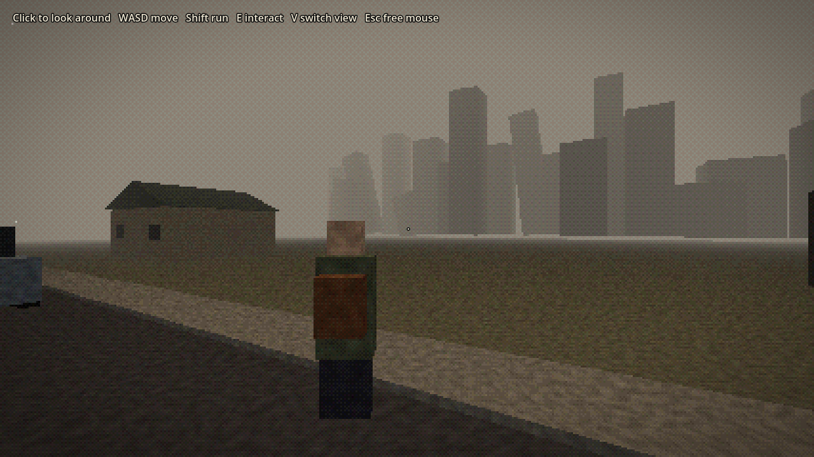
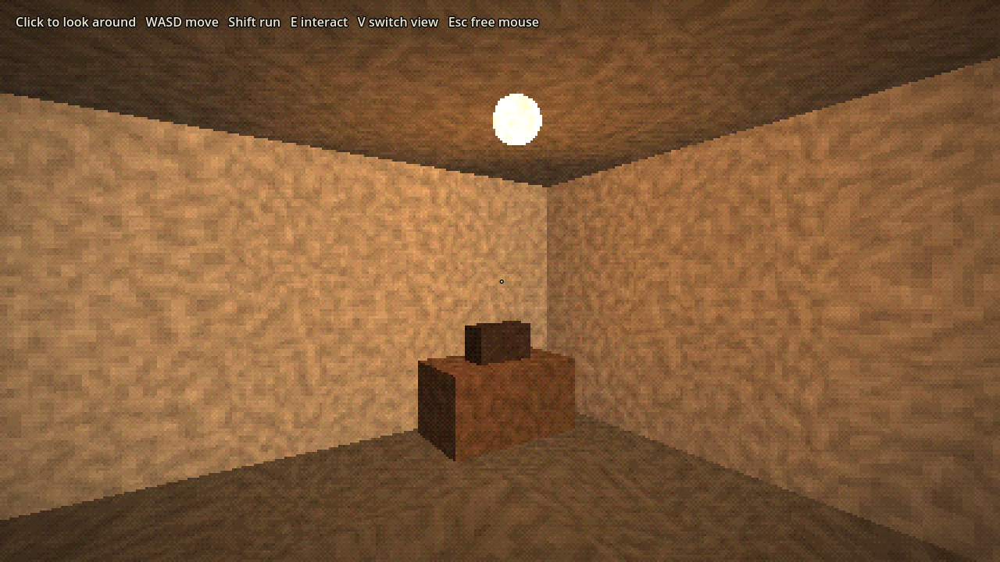
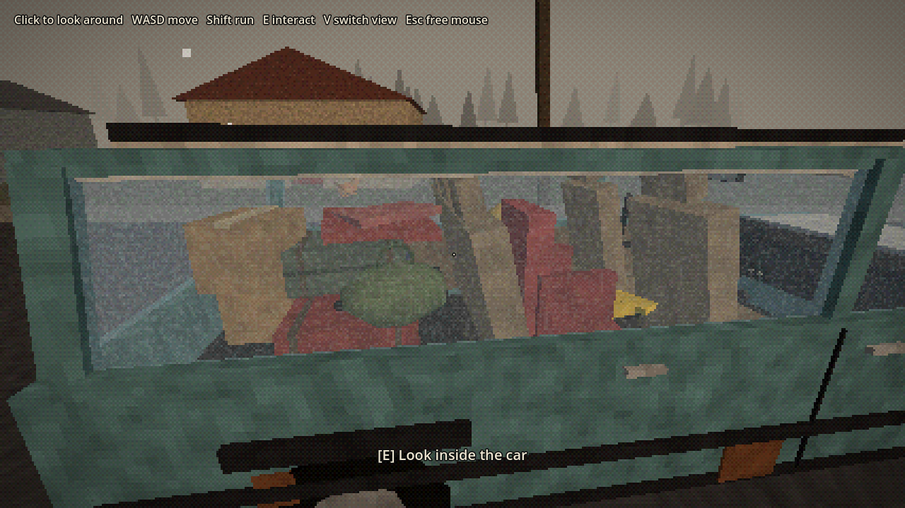

# Static Outskirts (working title)

A cozy, lonely exploration game set on the outskirts of a city a few months
after several nearby nuclear strikes. The world shows the horror; playing it
should feel gentle. A radio keeps picking up a broadcast that shouldn't exist,
and the signal gets stronger toward the forest.

This is the first small test scene, built in **Godot 4.4** (MIT licensed).






## Running it

1. Download Godot 4.4 or newer (standard version, not .NET) from https://godotengine.org/download
2. Open Godot, click **Import**, and pick this folder's `project.godot`.
3. Press **F5** (or the play button).

## Controls

| Key | Action |
| --- | --- |
| Click | Capture the mouse to look around |
| WASD / arrows | Move |
| Shift | Run |
| E | Interact |
| V | Switch first / third person |
| Esc | Free the mouse |

## What's in the scene

- Your house with a warm lamp, a bed, and the radio (the mystery starts here).
- A neighbour's house, a burnt house, and a house with a calendar stuck in March.
- Five detailed cars (estate, saloon, hatchback, van, pickup) with see-through
  windows and furnished interiors: the packed family car that never left, a
  saloon crashed into a power pole, the bakery van someone has been sleeping in,
  a rusted hatchback on flat tyres, and a pickup loaded with a whole bedroom.
- A shy stray cat that trusts you a little more each time you pet it.
- The dead treeline to the north with a blinking radio tower, and the hazy city to the south.

## How the look works

- `scripts/main.gd` renders the 3D world at 1/3 resolution and scales it up with hard pixels.
- `shaders/ps1.gdshader` snaps vertices to a coarse grid (the PS1 wobble), warps
  textures (affine mapping), lights per vertex, and fades to fog.
- `shaders/screen.gdshader` reduces colour depth with ordered dithering.

Everything is built from placeholder blocks in code, so it is easy to move
things around while we find the feel. Real models can replace them later.

## Screenshots from the command line

```
godot --path . -- --shot=out.png [--inside | --outside | --north | --car | --carin | --carback | --crash | --van] [--third]
```
