# Static Outskirts (working title)

A cozy, lonely exploration game set on the outskirts of a city a few months
after several nearby nuclear strikes. The world shows the horror; playing it
should feel gentle. A radio keeps picking up a broadcast that shouldn't exist,
and the signal gets stronger toward the forest.

This is the first small test scene, built in **Godot 4.4** (MIT licensed).


## Running it

1. Download Godot 4.4 or newer (standard version, not .NET) from https://godotengine.org/download
2. Open Godot, click **Import**, and pick this folder's `project.godot`.
3. Press **F5** (or the play button).

## Controls

| Key | Action |
| --- | --- |
| Click | Capture the mouse to look around |
| WASD / arrows | Move |
| Shift | Run |
| E | Interact |
| V | Switch first / third person |
| F | Torch on / off |
| T | Skip an hour (for testing) |
| G | Check the Geiger counter (once you've picked it up) |
| Tab | Backpack (items, and things you can do with them) |
| J | Sam's journal |
| A / D or mouse wheel | Turn the radio dial (Shift for fine tuning) |
| Esc | Free the mouse |

## What's in the scene

Alder Street, a few months after the strikes. Every house has real window and
door openings, a roof with gutters and a chimney, a porch, inner walls and a
small story inside.

- **No. 4, your house:** bedroom, kitchen with a working kettle, the radio on
  the table, a map with the tower circled, Biscuit's blanket by the door, and
  the one warm lamp on the street.
- **No. 6, the Okafors:** Grace's note asking someone to feed Biscuit, the cat
  food in the cupboard, family photos, and Biscuit's collar on the nightstand.
- **No. 8, the Patels:** locked, boxes packed and labelled. Their car is
  outside with WAIT FOR US written in the dust.
- **No. 3, the Bells:** a broken window, breakfast never eaten, the calendar
  that says "drill?", a child's drawing with three suns, and a walkie-talkie
  with a frequency taped to it.
- **No. 5:** Mr. Lindqvist's burnt-out house.
- **No. 7:** boarded up from the inside. NO ONE HERE.
- **The empty lot:** a swing set, one swing still moving, and a buried tin.
- **The street:** cracked road, kerbs and pavements, power poles with sagging
  and snapped wires, one streetlight that still flickers, picket fences,
  mailboxes, bins, hydrants, missing-person posters, and the evacuation bus
  stop with suitcases left in a row.
- **Five detailed cars** with see-through windows and furnished interiors.
- **Nature:** dead grass, bushes, bare trees, a dark pine forest to the north
  with a blinking radio tower, and the hazy city to the south.
- **Biscuit** walks, sits and looks around. **Sam** has an anime-style look: a
  painted face with big shiny eyes and blush, spiky bangs, two braids and a
  cowlick poking out of her teal pompom beanie, an oversized yellow raincoat and
  red wellies. Animated in third person. Footsteps and wind are generated in code for now.

## Things to do

- **Search** cupboards, wardrobes and desks for useful things: candles,
  matches, tea, tins, socks, a first aid box. Everything goes into the backpack.
- **Feed Biscuit:** Grace's note at No. 6 says the cat food is in her
  cupboard. Fill the bowl by your front door (once a day) and Biscuit walks
  in to eat. Each meal, like each time you pet him, builds his trust. After
  the first meal he moves into the blanket by your door.
- **Biscuit's collar** is on Grace's nightstand. Once he trusts you, put it
  back on him from the backpack.
- **Tom's tape:** dig up the tin under the swing at the empty lot, find Tom
  Bell's Walkman in the Bells' kids' room, and play it from the backpack.
- **The journal** fills in by itself as Sam finds things, hears stations,
  feeds Biscuit and sleeps, grouped by day.

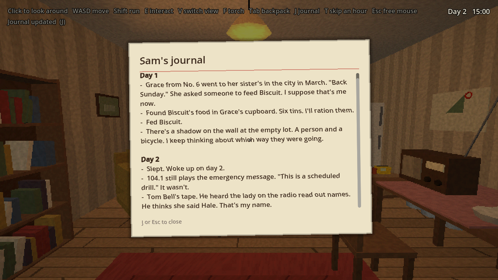
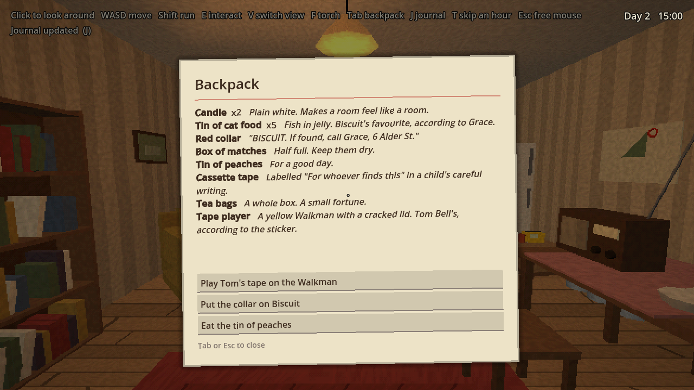

## Weather, comfort and saving

- **Title screen** over your kitchen: Continue (if there's a save), New game, Quit.
- **Weather** changes each day: grey on day 1, rain on day 2, ash fall on
  day 3, then a mix (sometimes clearer). Rain falls around you, hisses outside
  and drums on the roof when you're indoors. Ash days are thick and grey.
- **Home comfort:** inside your house the corner shows how cozy it is. Put
  candles on the five saucers (you need matches), let Biscuit move in, make
  tea, and leave the radio on 96.4. The morning line after you sleep depends
  on how cozy the house was.
- **Saving:** the game saves every time you sleep (to `user://save.json`).

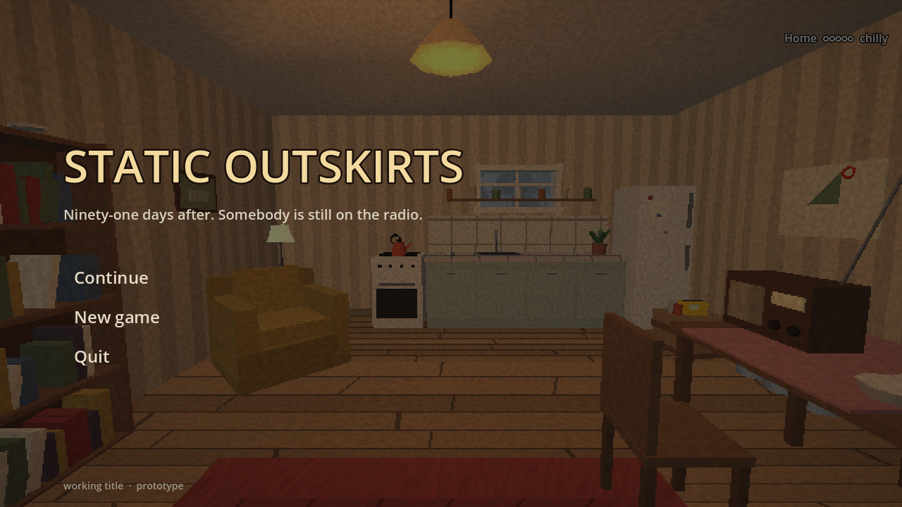
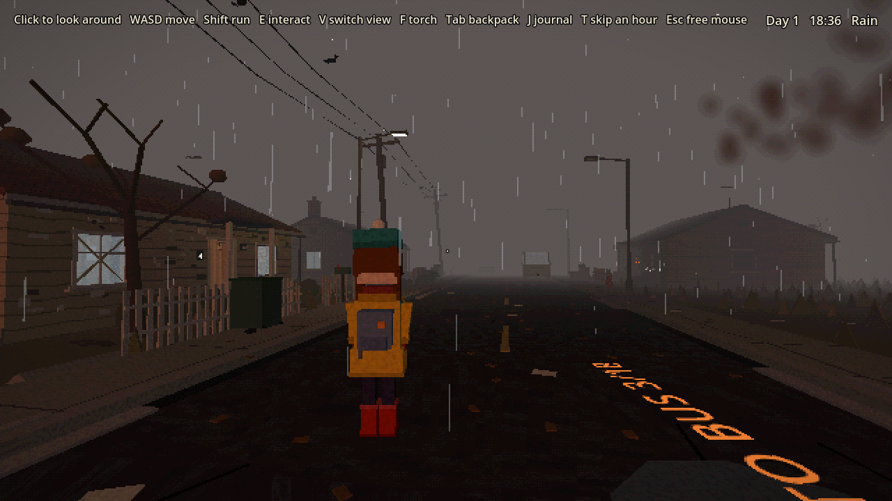
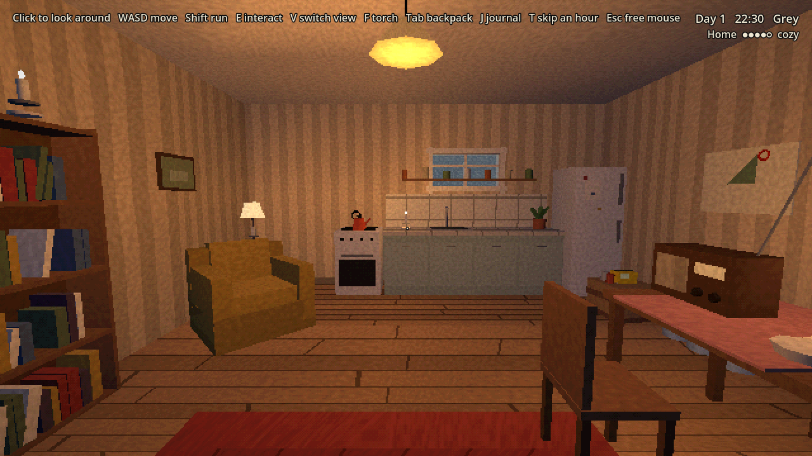

## Signs of the strikes

All in `scripts/aftermath.gd`. The city (and the flash) was to the south.

- **The flash:** a garden wall at the empty lot bleached pale except for the
  shadow of a person walking a bicycle and a ladder; blistered paint on the
  sides of houses that faced the city.
- **The blast wind:** trees and power poles leaning north, snapped trunks,
  roof tiles on the lawns, glass on the pavements, windows blown in. Your
  house has one window taped in an X and one covered in plastic sheeting.
- **Fallout:** grey ash drifted in the gutters and against fences, dead birds,
  a melted wheelie bin.
- **The days after:** government leaflets ("tune to 104.1"), sandbags, search
  team X marks on doors, an abandoned decontamination tent with a clipboard,
  a radiation warning sign, the Bells' garden shelter with a tally of days,
  a memorial on Mr. Lindqvist's fence, a dog lead on a lamppost, HELP painted
  on the road, chalk hopscotch and three suns.
- **The strange:** crows on the wires all facing the tower, pale moths around
  the one working light at night, little flowers that only open and glow after
  dark, the city still smoking with an orange glow at night.
- **Geiger counter:** on the crate in your kitchen. Once you pick it up it
  ticks, faster near hot spots (the crashed car, the decon tubs, the forest).

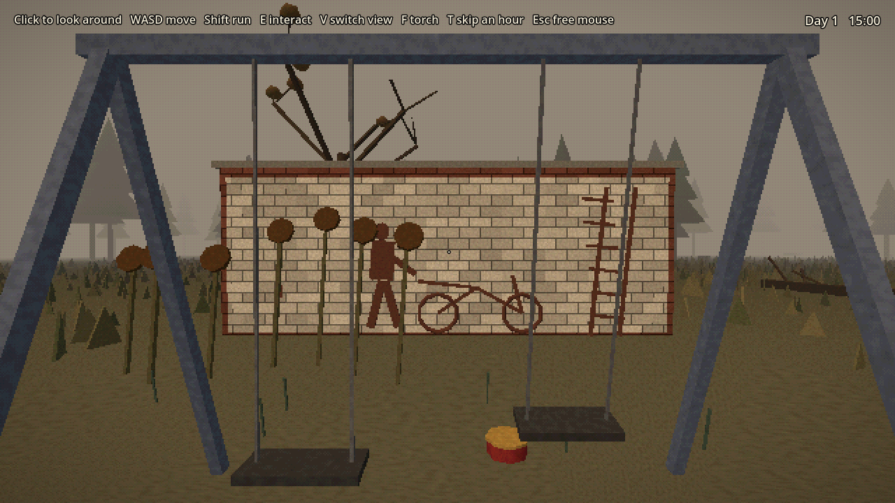
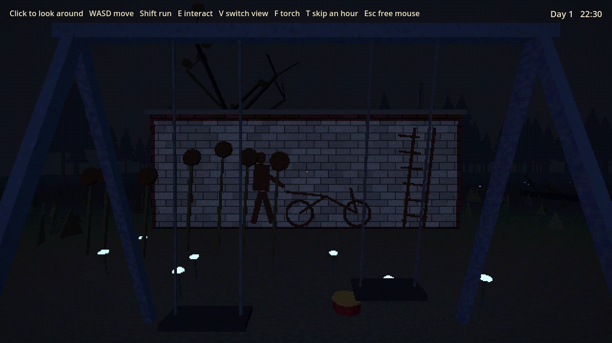
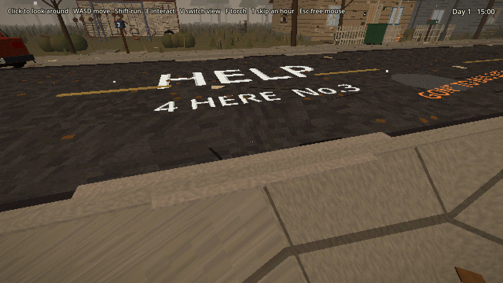
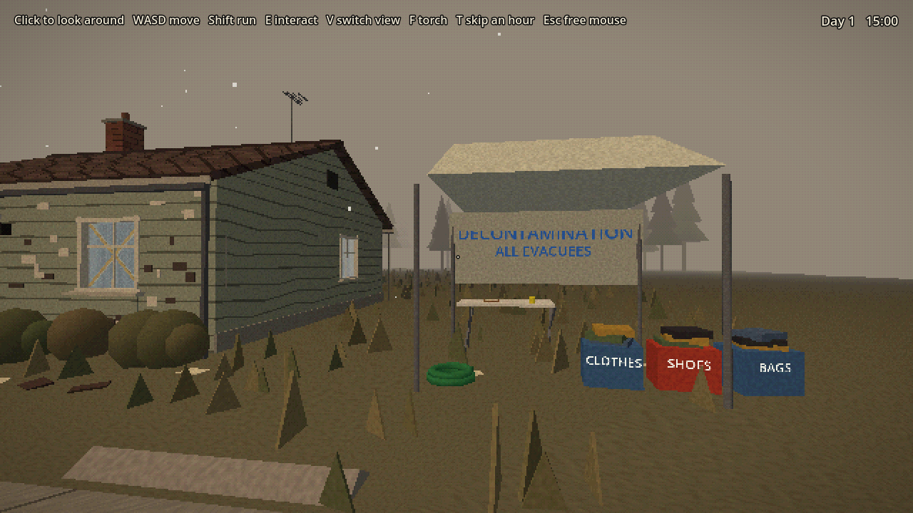
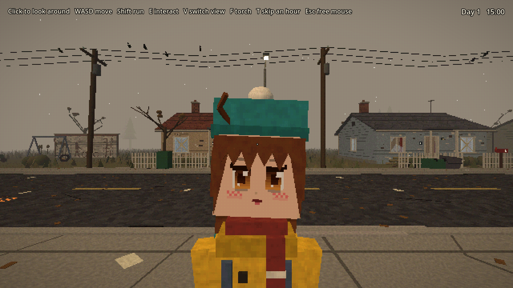

## Time, sleep and the radio

- **Day and night:** one in-game hour lasts a real minute. The game starts on
  Day 1 at 15:00. Sun, sky, light and fog shift through dawn, day, dusk and a
  dark blue night. The clock is in the top-right corner.
- **Sleep:** in the evening (after 19:00), press E on your bed to sleep until
  07:00 the next morning.
- **The radio:** press E on it to sit down and tune it (87.5 to 108 MHz).
  Static fades as you get close to a station; hold it for a moment to make out
  what it says.
  - **91.3:** the tower. Only after dark. Each time you find it, you hear the
    next part of the broadcast.
  - **96.4:** a music box tape on a loop (the number taped to the Bells'
    walkie-talkie).
  - **104.1:** the emergency service, still looping its "this is a drill"
    message.

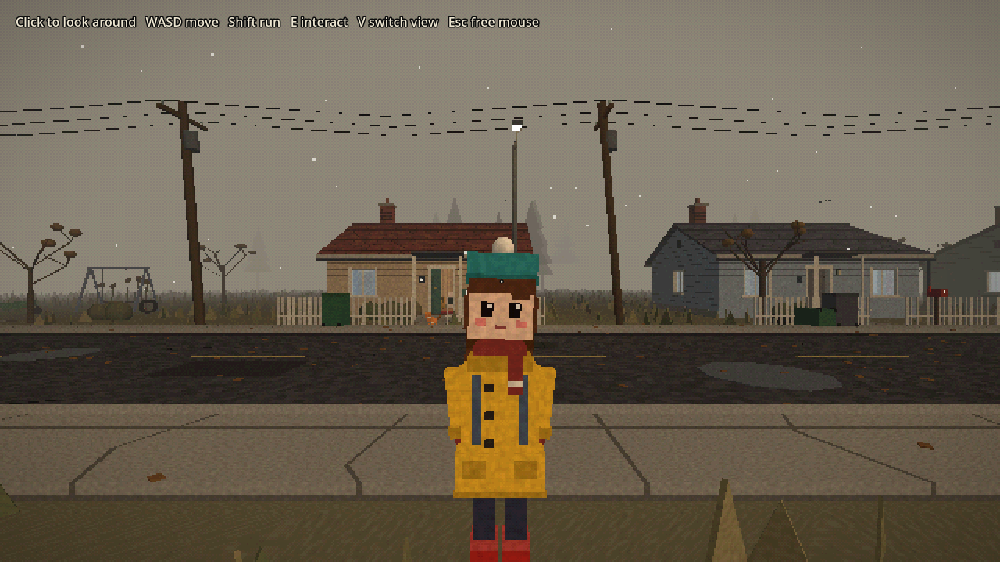
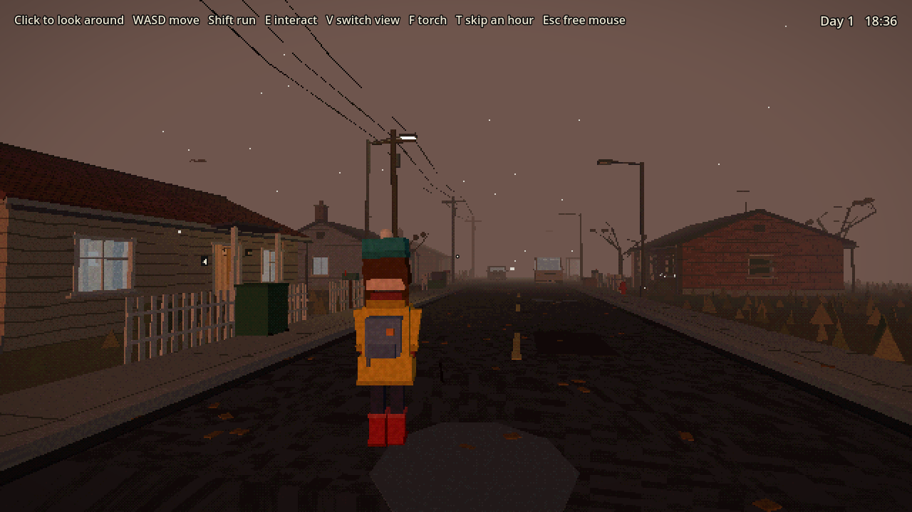
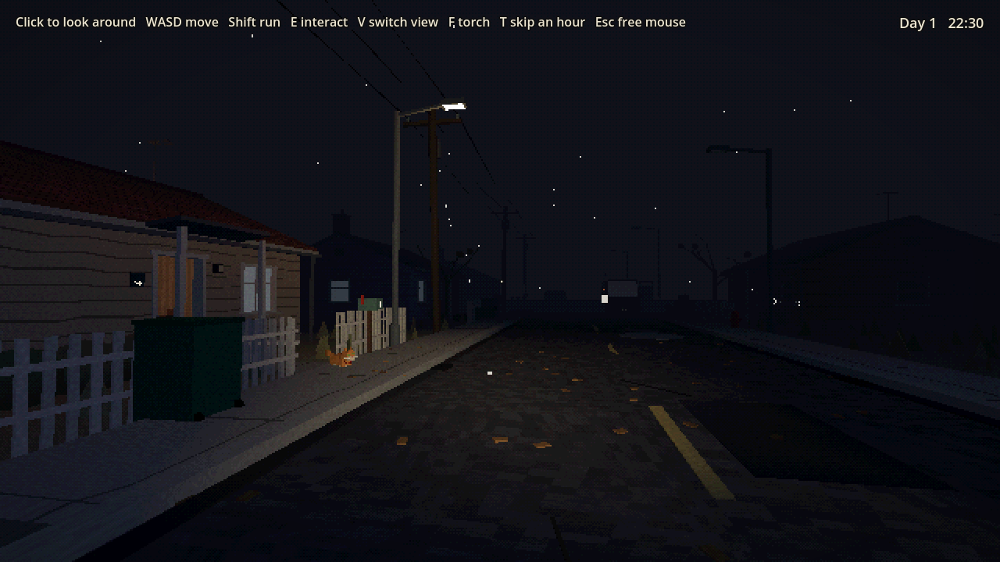
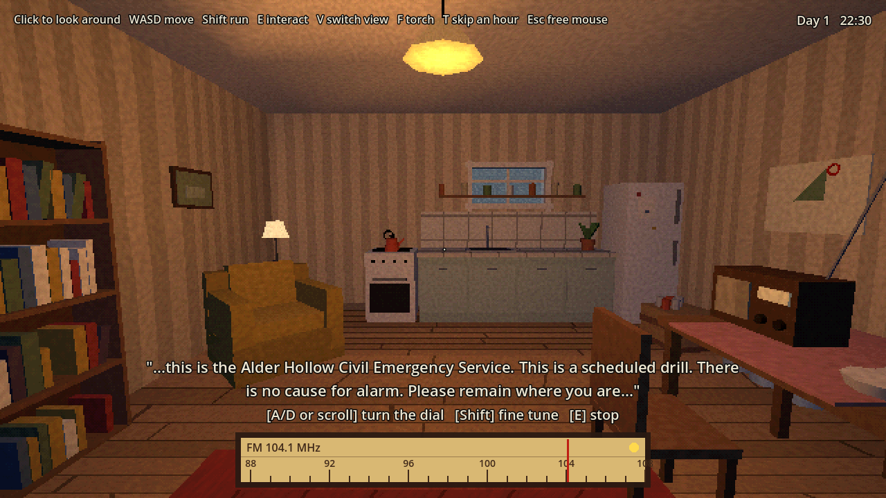

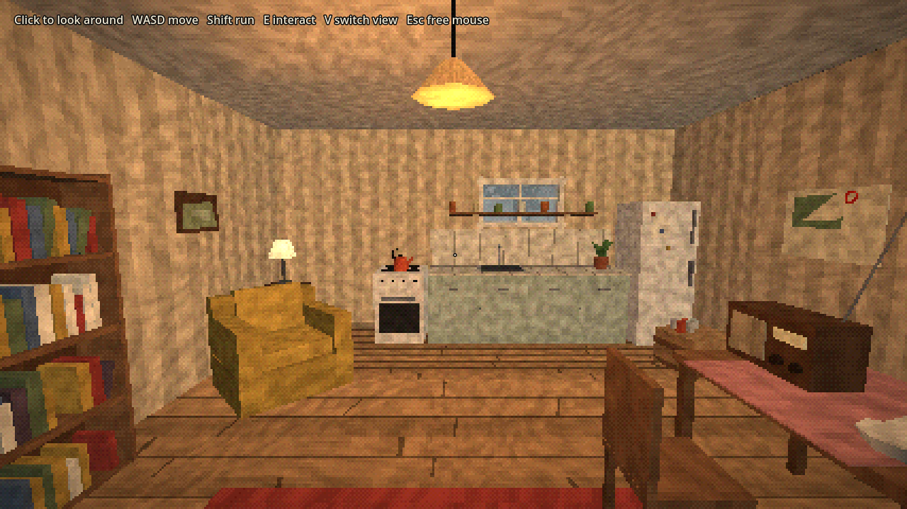
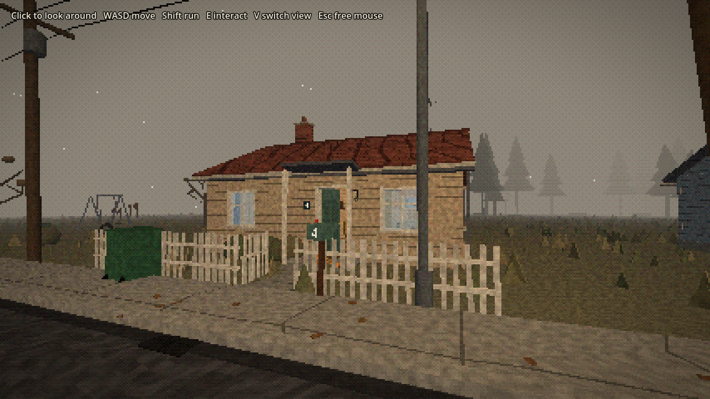

## How the look works

- `scripts/kit.gd` holds the shared shapes and materials; `furniture.gd`,
  `houses.gd`, `cars.gd` and `street.gd` build everything from them.
- `scripts/main.gd` renders the 3D world at half resolution and scales it up with hard pixels.
- `shaders/ps1.gdshader` snaps vertices to a fine grid (a light PS1 wobble), warps
  textures (affine mapping), lights per vertex, and fades to fog.
- `shaders/screen.gdshader` reduces colour depth a little with light ordered dithering
  and adds a soft vignette.
- `scripts/daynight.gd` sets the shared `world_fog` and `fog_scale` shader
  values, the sun and the ambient light for the time of day.

Everything is built from placeholder blocks in code, so it is easy to move
things around while we find the feel. Real models can replace them later.

## Screenshots from the command line

```
godot --path . -- --shot=out.png [--home | --kitchen | --bedroom | --yourhouse | --okafor | --street | --lot | --busstop | --cat | --car | --crash | --van | --road | --flash | --decon | --help | --memorial | --wires | --shelter] [--third | --face [--close]] [--dusk | --night] [--torch] [--tuning] [--journal | --backpack] [--rain | --ashfall] [--candles] [--title]
godot --path . -- --selftest   # presses E on a few things, saves, prints what happens
godot --path . -- --loadtest   # loads that save and prints it
```
